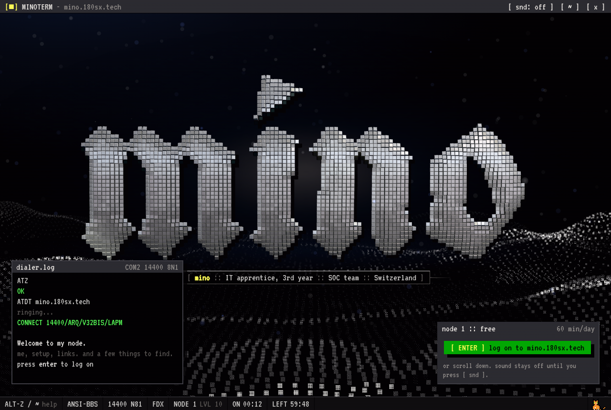

<h1 align="center">Hi, I'm mino</h1>
<h3 align="center">I build small tools and look at JDM cars</h3>

## about_me.c

```c
#include <stddef.h>

struct me {
	const char *handle;
	const char *role;
	const char *const *setup;
	const char *const *languages;
	const char *const *into;
	const char *garage;
};

static const struct me mino = {
	.handle    = "minomat180",
	.role      = "IT apprentice, 3rd year, SOC team",
	.setup     = (const char *const[]){ "a MacBook I sit at",
	                                    "an old MacBook running NixOS as a home server",
	                                    "Tailscale in between", NULL },
	.languages = (const char *const[]){ "C", "Go", "JavaScript", "TypeScript",
	                                    "Python", "shell", NULL },
	.into      = (const char *const[]){ "self-hosting", "coding agents", "racing games",
	                                    "Cowboy Bebop", "jazz late at night", NULL },
	.garage    = "learner's permit, one day an S13 Silvia",
};
```

<a href="https://mino.180sx.tech"></a>

## What I am working on

- [agent-chrome](https://github.com/minomat180/agent-chrome) - lets coding agents drive one real, signed-in Chrome
- [agent-vault](https://github.com/minomat180/agent-vault) - an agent uses a secret in one command without seeing it
- [ipod-vault](https://github.com/minomat180/ipod-vault) - age-encrypted password vault on an iPod
- [agent-setup](https://github.com/minomat180/agent-setup) - restore kit for my two-machine agent setup
- [agent-garage](https://github.com/minomat180/agent-garage) - a NixOS microVM per friend for their coding agents, reachable only through Cloudflare Access
- [capri-desktop](https://github.com/minomat180/capri-desktop) - Capri, a desktop companion that narrates Claude Code, on Linux and macOS
- [lenotch](https://github.com/minomat180/lenotch) - MacBook notch utility: now playing, file shelf, HUDs
- [phosphene](https://github.com/minomat180/phosphene) - vibe-coded fork of Phosphene: video wallpaper on the lock screen, its own image on the desktop
- [180sx.tech](https://github.com/minomat180/180sx-zine) - a Nissan 180SX fan zine as a fake Windows 98 desktop
- [mino.180sx.tech](https://mino.180sx.tech) - my personal page

> Whatever happens, happens. — Spike Spiegel
